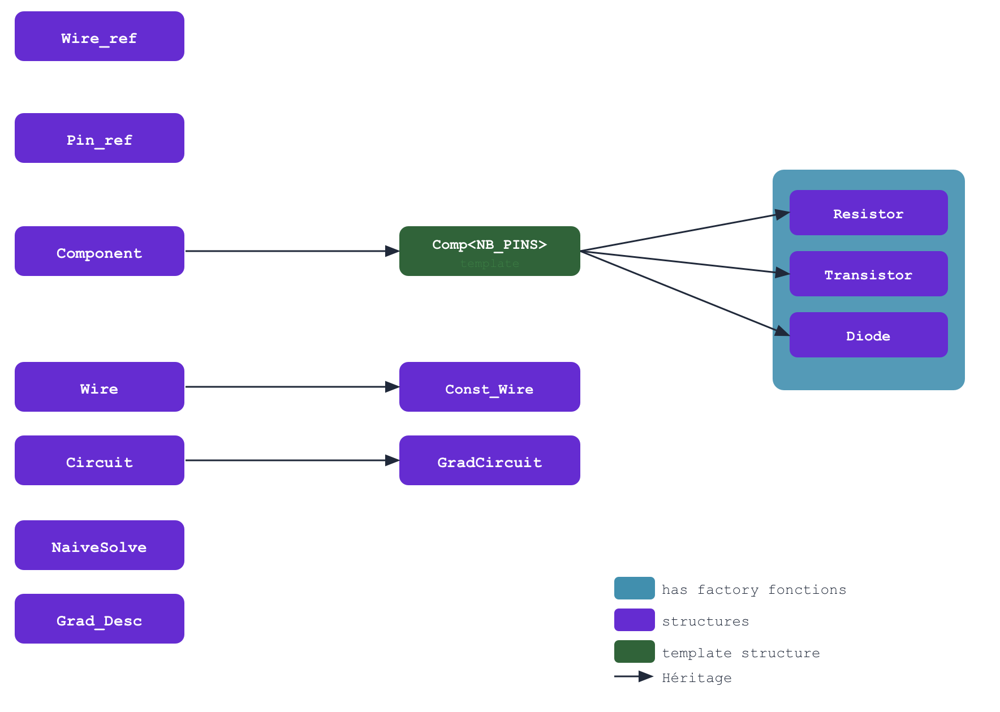

# Miléna - Portfolio

Welcome to my portfolio! I'm Miléna, an engineering student at CentraleSupélec, in France.
--- 

<table align="center">
    <tr><td> Languages</a></td></tr>
    <tr><td> French ★★★★</a></td></tr>
    <tr><td><a href="README.md"> English ★★★☆</a></td></tr>
    <tr><td> Spanish ★★☆☆</a></td></tr>
    <tr><td>Japanese ★☆☆☆</a></td></tr>
</table>

--- 

## 🛠️ Personal Projects

### [Analogic Circuit Simulator]

**Description**: A lightweight, extensible C++20 library for simulating the steady-state behavior of analog electronic circuits. The project models Kirchhoff's Current Law as an error function to be minimized, letting you solve circuits by finding the node potentials that satisfy the laws of physics. Includes built-in models for resistors, diodes (Shockley), and transistors (Ebers-Moll).

**Programming language**: C++ 20

**Links**: [View Repository](https://github.com/milenacdg/analogic_circuit_simulator)

---

- 🛠 &nbsp; I’m currently working with Python, C++, Docker etc.
- 🚀 &nbsp; I’m currently exploring ML, DeepLearning, Statistical Models, etc.
- 📫 &nbsp; Reach me out: [milenacdg@gmail.com](mailto:milenacdg@example.com)

### My Absolute Favorites:

- 💻 &nbsp; I love exploring new technologies and building cool stuff.
- 📰 &nbsp; Reading, writing & watching Tech Stuff whenever possible.

### Languages and Tools:

<code></code>
<code></code>
<code></code>
<code></code>

